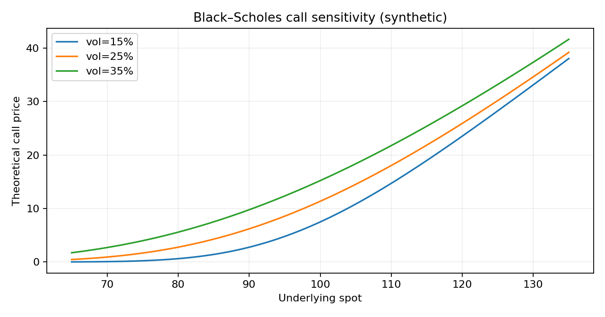

# Equity Derivatives Pricing, Volatility & Hedging (Python)

**[▶ Launch the interactive Streamlit demo](https://equity-derivatives-pricing-volatility-hedging-rznaftgc3qtjysnb.streamlit.app)** — try the dashboard in your browser, no Python installation needed.

**Explore:** [Python source](src/) · [Streamlit app code](app.py) · [Unit tests](tests/) · [Chart preview](assets/equity-options-preview.png) · [Run instructions](#run)

*The default example uses synthetic inputs; this is educational research, not live trading or an investment recommendation.*


**Front-office-oriented research prototype**: Black–Scholes vanilla calls/puts and Greeks; antithetic Monte Carlo pricing for arithmetic-average Asian calls and discretely monitored up-and-out calls; 25Δ risk-reversal / butterfly quote analytics; and financed discrete delta-hedging P&L for a short vanilla call.



*Model-generated synthetic example, not live-market results.*

## Run

```bash
python -m pip install -e '.[dev]'
python -m pytest -q
python examples/run_demo.py
streamlit run app.py
```

## Real / synthetic data boundary

The pricing and hedging paths are **synthetic** risk-neutral GBM scenarios. Optional `fetch_fred()` retrieves **real historical** FRED `SP500` index levels or `VIXCLS` (VIX), solely as an external market-context chart. These are **not** an options chain, implied-volatility smile, or option settlement data. For a genuine historical smile/hedging study, supply licensed strike-by-strike option marks, underlying/dividends, timestamps and execution prices.

## Models and limitations

- Constant rates/volatility, continuous trading theoretical benchmark; simulated exotic monitoring only on a discrete grid; antithetic variance reduction.
- Hedge self-finances cash at `exp(rΔt)` with q=0 and proportional transaction costs; no discrete dividends, margin, funding spreads, volatility surface dynamics or execution delays.
- Inputs for 25Δ RR and BF assume **matched delta/expiry definitions**; the dashboard does not derive a surface from real option quotes.
- This is research/demo software, **not production pricing, advice or a claim of prior live trading P&L**.

### Original academic work
The independently preserved [Exotic Options Lab](https://github.com/SLeHello56/Sales-Trader-finance-projects/tree/main/Project_1_%20Exotic%20Options%20Lab) remains in the existing GitHub portfolio; this is a separate, extended Python implementation.

**CV description:** *Modeling vanilla & exotic options, implied volatility quotes, Greeks and discrete delta-hedging P&L (Python).* Only claim delivered functionality described above.
